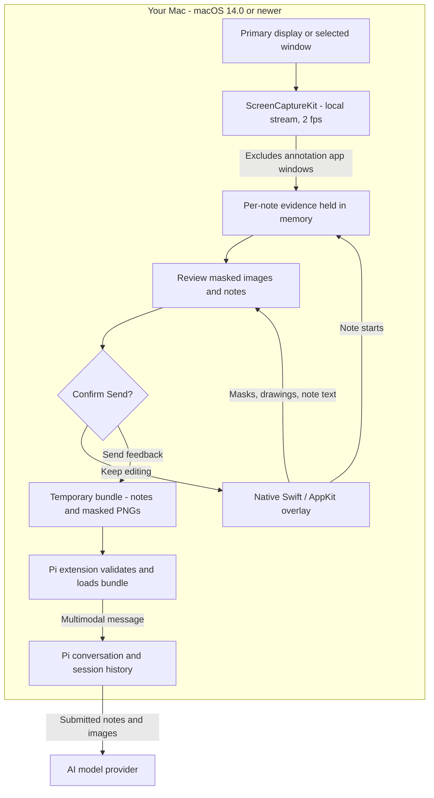

# Pi Desktop Annotate

**Native, live desktop annotations for Pi — built for macOS 14.0 (Sonoma) or newer.** Add notes, drawings, crops, and privacy masks over your running applications, then send visual feedback to an image-capable Pi model. No Electron, browser extension, or frozen desktop.

A movable toolbar and transparent drawing layer keep your desktop usable while you annotate. Each note retains the screen as it looked when you started that note, so you can close a popup or switch applications without losing earlier evidence.

> **Local until you Send.** Capture and editing happen on your Mac. Explicitly confirming **Send** shares notes and exported screenshots with Pi, which can store them in session history and send them to your model provider. Review every image before sharing.

## How it works



The stream itself is never sent to Pi. The temporary Send bundle is removed after loading or cancellation; submitted content can remain in Pi history and with the provider. [Storage details](#storage-and-workspace-boundaries).

## Contents

- [Requirements](#requirements)
- [Install and launch](#install-and-launch)
- [First annotation](#first-annotation)
- [Using the overlay](#using-the-overlay)
- [Evidence semantics](#evidence-semantics)
- [Pi integration](#pi-integration)
- [Storage and workspace boundaries](#storage-and-workspace-boundaries)
- [Privacy, resources, and lifecycle](#privacy-resources-and-lifecycle)
- [Troubleshooting](#troubleshooting)
- [Standalone use](#standalone-use)
- [Development and tests](#development-and-tests)

## Requirements

- **macOS 14.0 (Sonoma) or newer**, with a local graphical desktop. This package targets macOS only; Linux and Windows are not supported.
- **Apple silicon or Intel Mac.** The native helper is built for the architecture of the Node.js process used to build it; it is not a universal binary.
- **Node.js 22+** and npm, plus [Pi](https://www.npmjs.com/package/@earendil-works/pi-coding-agent) and an **image-capable model**. Development targets Pi's 1.5.x extension APIs.
- **Xcode Command Line Tools**, including the Swift compiler and a macOS 14-capable SDK. Install with `xcode-select --install`, and update the tools if your SDK is older.
- **Screen Recording permission** for Pi Desktop Annotate (or its launching application, depending on macOS attribution).

There is no Electron, image-import, or remote-desktop fallback. Capture supports the primary display or a selected window.

## Install and launch

### 1. Prepare your Mac

Install Pi and the requirements above. If Command Line Tools are not installed:

```sh
xcode-select --install
```

### 2. Install from a local checkout

Download or clone this package. Replace `/path/to/...` with your own paths:

```sh
cd /path/to/pi-desktop-annotate
npm install
npm run build:native
pi install /path/to/pi-desktop-annotate
```

Keep the local checkout available when installing from a path. No prebuilt native binary is required.

### 3. Launch from your project

```sh
cd /path/to/your-project
pi
```

Choose an image-capable model, then run:

```text
/annotate
```

If Pi was already running when you installed the extension, run `/reload` first.

To try without installing, launch Pi from your project with the extension path:

```sh
pi -e /path/to/pi-desktop-annotate/src/index.ts
```

The extension checks/rebuilds the native helper incrementally when `/annotate` runs. No native compilation happens on Pi startup. The resulting app is under **`build/Pi Desktop Annotate.app`**. Builds are local, architecture-specific, and ad-hoc signed—not Developer ID signed or notarized. The build directory must be writable. A distributable signed binary is future work.

### First-run permissions

The toolbar opens without requesting capture permission. Choose an annotation tool (Note, Region, Draw, Mask, or Crop), or click **Desktop ▾** in the toolbar, to open capture settings. Choose **Enable Screen Access** when ready. If access is declined, the toolbar stays open with an **Open Settings** option for **System Settings → Privacy & Security → Screen & System Audio Recording**. Reopen the toolbar popover after enabling access to retry.

The companion is launched through LaunchServices (`open`), so it is its **own** permission target: the Screen Recording toggle to enable is **Pi Desktop Annotate** itself, not your terminal or Pi. This avoids the case where a sandboxed launcher is treated as the responsible process. After enabling, fully quit the toolbar and run `/annotate` again rather than using macOS's "Quit & Reopen". Because the app is ad-hoc signed, its permission is keyed to the built binary: rebuilding or moving it changes its identity and can require granting access again. If the toolbar keeps showing **Enable Screen Access** while Settings shows it enabled, remove the stale entry, run `tccutil reset ScreenCapture local.pi.desktop-annotate`, rebuild, and re-grant.

No Accessibility or microphone permission is needed. If ScreenCaptureKit cannot identify and exclude this app, it fails rather than capturing its own toolbar/cards.

## First annotation

1. Run `/annotate` in Pi. The toolbar opens without capturing your screen yet.
2. Click **Desktop ▾**, choose the primary display or an application window, and enable screen access when prompted. Click **Start annotating**.
3. Select **Note** and click a location, or use **Region** / **Crop** to select an area. Type your feedback and click **Save** (⌘Return).
4. Add **Mask** boxes over private areas. Choose **Interact** whenever you need to click or scroll in the underlying application.
5. Open **Review** and inspect every evidence image and note. Earlier notes keep their original screenshots, even if the screen has changed.
6. Click **Send**, then confirm **Send feedback**. Pi receives the batch and responds; if busy, it queues the feedback as a follow-up.

To leave without sharing, use `/annotate cancel`. Unsent drafts are not saved after the app exits.

## Using the overlay

Use the toolbar’s source button to choose **Entire desktop · primary display** or a specific app window, then **Start annotating**. When opened from an annotation tool, that tool activates after capture starts. Cancel or click outside the popover to dismiss it without closing the app or sending anything. Send or clear existing annotations before changing source to keep evidence aligned. Window capture includes only that window, not surrounding apps. The annotation layer follows the window when it moves. Resizing or closing the selected window stops capture to prevent misaligned evidence; existing notes can still be sent. Bring the selected window into view before annotating it.

The desktop always stays live. There is no capture/freeze mode.

| Tool | What it does |
| --- | --- |
| **Interact** | Click and scroll through underlying apps. Existing notes, masks, and drawings stay visible. |
| **Note** | Click a location to open a note card and retain the current evidence frame. |
| **Region** | Drag a rectangle and attach a note with full-screenshot context. Evidence is retained at the start of the drag. |
| **Crop** | Drag a rectangle and attach a note. Only that rectangle is included in Review and sent for this note—not the entire screenshot. Evidence is retained at the start of the drag. |
| **Draw** | Draw freehand over the live desktop. |
| **Mask** | Draw a solid black box over private areas. Masks apply to every exported image. |
| **Undo** | Undo a note creation, mask, or stroke. Text fields retain normal text editing. |
| **Clear** | Discard this batch after confirmation, without restarting the stream. |
| **Review** | Inspect masked evidence images and their matching numbered notes before sharing. |
| **Send** | Confirm sharing and submit the batch to Pi. |
| **Minimize (yellow)** | Hide the toolbar, cards, and marking layer without discarding drafts; switch back to click-through. Run `/annotate` again to restore. Local capture continues. |
| **Close (red)** | Discard and exit after confirmation if there are unsent changes. |

Drag the toolbar's **title bar** to move it out of the way. The Review badge shows the number of notes in the batch. Hover over controls for tooltips; focus the tool selector and use the left/right arrow keys to change tools.

Each note has a category: **Note**, **Bug**, **Change**, or **Question**. **Save** (⌘Return) keeps it locally and closes its editor; click its blue pin while an annotation tool is active to reopen it. **Cancel** (Escape) discards a new note or restores the last saved version of an edited note. Draft text is retained while typing and included on Send, even if you have not clicked Save. Each card supports up to 2,000 characters.

Selecting a marking tool intercepts pointer input on the desktop so a stroke is not mistaken for clicking the application beneath. **Interact** restores click-through without deleting anything. Cards and the toolbar themselves remain interactive. This is an input-routing distinction, not a paused screen.

**Send** opens a source-aware summary of the notes and screenshots being shared, with **Send feedback**, **Keep editing**, and **Review screenshots** actions. Return does not send accidentally. Capture source is selected before annotating, not at Send, because each note retains its original screenshot.

Use **Review** to inspect each saved state. Numbered pins stay on the image; a scrollable side panel lists each associated note under its original pin number, with its category and full text. Switching evidence images also switches the note list. Closing Review does not send anything or stop the stream. Review is a static snapshot of images and note text, not the annotation surface; reopen it after editing to refresh the snapshot.

`/annotate cancel` closes the helper without sharing. Pi shutdown, reload, or session replacement also terminates it and cleans up temporary handoff files. This native version does not register the previous Electron version's global keyboard shortcuts.

## Evidence semantics

- Each note stores the most recent stream frame when the note gesture **starts**, before its text card opens.
- The stream targets **2 frames/second**. Evidence can lag the interaction; this is not frame-exact video synchronization. Static frames are reused when ScreenCaptureKit reports an idle display. Unavailable, suspended, or stale frames are rejected.
- Moving windows and switching apps do not update earlier notes' evidence.
- Notes reference numbered evidence images in the Pi handoff. Several normal notes can share a frame.
- Each **Crop** note exports its own cropped image, with coordinates relative to that crop. Ink and masks are applied before cropping; pixels outside the selected rectangle are not included in the exported PNG. Full captures remain local in memory until the batch is discarded or the app exits. A crop does **not** restrict other Note/Region notes: those still export full screenshots. Review every image when mixing tools.
- Pins are fixed locations within the capture source: desktop pins **do not track UI elements** as windows move; selected-window pins move with that window, but do not track elements inside it.
- Drawings and masks apply at the same normalized screen locations to **all** evidence images. They do not each retain a timeline. For drawing/mask-only batches, evidence is retained at the first mark.
- Review/export images contain pins, regions, ink, and masks—not toolbar or card windows. Note text is sent separately.

**Important:** masking a location is not semantic secret detection. If a password moves between evidence frames, one mask may not cover it everywhere. Review **every image** and all note text before Send. Masks are rendered last as opaque pixels and cannot be removed from exported PNGs to recover the original area.

## Pi integration

The companion writes a versioned local bundle only after explicit Send. The extension validates filenames, note/frame references, image dimensions, sizes, and regular-file boundaries, then submits one multimodal annotation message (user-role model context). If Pi is busy, the feedback is queued as a follow-up.

In Pi, feedback is headed **pi-desktop-annotate**, followed by **each screenshot's notes and an inline image preview**. Coordinates, dimensions, capture caveats, and agent instructions are retained in model context but hidden from the user-facing presentation. Single-image feedback omits the screenshot heading; multi-image feedback uses simple sequential screenshot labels. The presentation is persisted in message details, without duplicating image bytes. Previews require a supported image-capable terminal; other terminals show an image fallback. Pi's `terminal.showImages` and `terminal.imageWidthCells` settings are respected. The same content is retained on reload/resume while this extension is loaded; there is no duplicate image-only transcript entry.

The model-facing format groups notes under their evidence ID, with `#id · category`, a compact `pin (x, y)` or `box (x, y, w, h)`, and the original note text. Shared evidence is attached once. Timestamps, filenames, and repeated per-note frame references stay in the validated local manifest instead of consuming prompt tokens. Pixel coordinates and capture semantics are explained once per batch; the version-2 on-disk schema remains compatible.

Limits per batch:

- 12 notes; up to 2,000 characters per card
- 8 exported evidence images (each Crop note uses one image, even when captures are shared)
- Evidence scaled to fit **1920 × 1080**, preserving aspect ratio
- 20 MB aggregate PNG payload
- 100 masks, 100 strokes, bounded stroke points, 40 undo actions

These limits bound retained memory and model context. If a limit is reached, send the batch and start another session. Models have their own image-count/size limits as well. Pi does not receive the screen stream, audio, video, DOM selectors, or an accessibility tree.

## Storage and workspace boundaries

| Data | Location / lifetime |
| --- | --- |
| Live screen frames and unsent notes | Companion memory; discarded on exit, no draft autosave |
| Review images | macOS temporary directory, `pi-review-<UUID>/`; removed after loading Review |
| Send handoff | Node's `os.tmpdir()`, `pi-annotate-<random>/`, containing `annotations.json` and masked `evidence-<id>.png`; removed in the extension's `finally` block after loading, cancellation, or failure |
| Submitted notes and screenshots | One Pi custom message, with PNGs encoded as base64; persisted in Pi's session JSONL when session persistence is enabled |
| Native helper | Package's `build/Pi Desktop Annotate.app`; intentionally retained for incremental builds |

On macOS the temporary root is typically under `/var/folders/.../T/`; it is resolved at runtime, not hardcoded. Pi's default session location is `~/.pi/agent/sessions/--<encoded-working-directory>--/<timestamp>_<session-id>.jsonl`, unless configured otherwise. Base64 adds roughly one third to PNG byte size. Removing the temporary bundle does **not** remove the session copy or a model provider's copy. Hiding image previews also does not disable persistence. There is currently no extension-level ephemeral-image mode.

The handoff includes the image bytes, not local file paths, so the model does not need access to the capture machine's temporary directory. The native capture companion itself still requires a local macOS graphical desktop; it is not a remote-desktop capture transport.

Feedback guidance tells the agent to answer questions/suggestions directly when possible, inspect only the current workspace or explicitly authorized paths, and ask before looking elsewhere for the pictured application's source. This is **prompt guidance, not a security sandbox**. Screenshots do not authorize access to sibling projects. Use host-level tool restrictions or an OS sandbox if filesystem isolation is required.

## Privacy, resources, and lifecycle

- No network endpoints, WebRTC peer connection, signaling server, browser runtime, telemetry, audio capture, or video encoder.
- The screen stream is active only while the companion runs. It is necessary to have evidence ready without hiding/freezing the desktop.
- The latest frame and bounded per-note frames remain in memory. Raw captures are not written to disk.
- Review briefly writes a **masked** private temporary bundle, loads the preview images, and removes the files. Export writes masked evidence PNGs and `annotations.json` into a private temporary directory for Pi. Pi removes it after reading.
- **Pi/model providers can retain submitted screenshots and note text in session history.** “Local” describes capture/editing, not what happens after Send.
- A crash can leave masked `pi-review-*` or `pi-annotate-*` files in the system temporary directory. There is no autosave or draft recovery.
- Retaining multiple high-resolution frames uses memory; native does not mean zero overhead. Runtime CPU/memory should be measured on the target machine.

Protected/DRM surfaces and secure system UI may be unavailable. Fullscreen-app/Space behavior needs manual testing. Display reconfiguration stops the stream to avoid misaligned evidence; close and reopen `/annotate` afterward. Entire-desktop capture targets the primary display; selected-window capture follows that window.

## Troubleshooting

| Symptom | What to check |
| --- | --- |
| Install or launch fails on Linux/Windows | This package requires macOS 14.0 or newer. The native companion cannot run in a Linux container. |
| Swift build fails | Check `sw_vers -productVersion`, `xcrun --find swiftc`, and `xcrun --sdk macosx --show-sdk-version`. Update macOS/Command Line Tools as needed; ensure the package's `build/` directory is writable. |
| Toolbar opens but capture is unavailable | Enable **Pi Desktop Annotate** under Screen Recording, fully quit the toolbar, and run `/annotate` again. The companion is its own permission target (launched via LaunchServices). See [first-run permissions](#first-run-permissions). |
| "Enable Screen Access" persists though Settings shows it enabled | The ad-hoc signature changed (rebuild/move) so the grant no longer matches. Remove the stale Screen Recording entry, run `tccutil reset ScreenCapture local.pi.desktop-annotate`, rebuild, and re-grant. |
| Send saves a bundle to disk instead of sending to Pi | The app wasn't launched by `/annotate` (no `--output`). Close it and start from `/annotate` inside Pi. |
| Pi asks for an image-capable model | Switch to a model that accepts images, then run `/annotate` again. |
| Toolbar is missing after minimizing | Run `/annotate` again to restore it. |
| Selected-window capture stops | Resizing/closing that window or changing display configuration stops capture to avoid misaligned evidence. Send or discard existing notes, then select a source again; reopen the companion after display changes. |
| Evidence looks older than expected | Capture targets 2 fps, and each note keeps its starting frame. Review the batch; this is not frame-exact video capture. |
| Sensitive content appears in Review | Keep editing and add masks, or discard the batch. Review every frame; one location mask may not cover content that moved. |

## Standalone use

```sh
npm start
```

The same native app runs without Pi. **Send** asks for an output folder rather than contacting an agent. The saved bundle contains `annotations.json` and `evidence-<id>.png` files and remains until you delete it.

## Development and tests

```sh
npm test              # versioned handoff validation and failure cases
npm run check         # strict TypeScript validation
npm run build:native  # Swift/AppKit + ScreenCaptureKit build, local ad-hoc signing
npm run test:desktop  # synthetic native UI/export and Pi-loader integration
```

The desktop test briefly opens native windows and uses generated images. **It does not capture the desktop or request Screen Recording permission.** It checks input routing, readable categories, preserved per-note frames, mask orientation and opacity, cropped image dimensions and rebased coordinates, separate crops of shared frames, mixed full/cropped exports, native PNG export, and the Pi multi-image loader.

Live stream exclusion, permission prompts, menus/popups, multiple Spaces, and actual click-through behavior need a manual permission-enabled test on your Mac. These are not covered by the synthetic smoke test.

Run these commands from the package checkout after `npm install`. Native build and desktop smoke tests require macOS 14.0 or newer; bundle validation and TypeScript checks do not require capture permission.

### Source layout

- `native/Capture.swift`: local ScreenCaptureKit stream, exclusion filter, bounded latest frame
- `native/main.swift`: native AppKit overlay, toolbar/cards, review, lifecycle
- `native/UI.swift`: shared dark surfaces, blue pins, accessible tool selector and action buttons
- `native/Model.swift`: per-note evidence and masked PNG/bundle export
- `scripts/build-native.mjs`: incremental compile and ad-hoc signing
- `src/index.ts`: Pi command, native process management, cleanup, queued multimodal handoff
- `src/feedback.mjs`: strict bundle validation, cancellation handling, and image loading

## License

[MIT](LICENSE).
